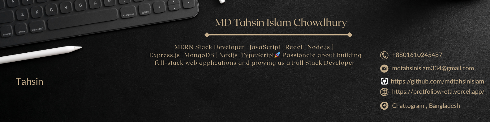

### Hi 👋, my name is MD Tahsin Islam Chowdhury
#### Web Developer 

💻I am a Full Stack Developer Experienced in | JavaScript | React | Node.js | Express.js | MongoDB | Nextjs | TypeScript 🚀 Passionate about building full-stack web applications .

## 🧑‍💻 Coding Vibes

  

## 🧠 Skills

  <!-- Vue.js -->
  
  &nbsp;&nbsp;
  <!-- React -->
  
  &nbsp;&nbsp;
  <!-- JavaScript -->
  
  &nbsp;&nbsp;
  <!-- HTML5 -->
  
  &nbsp;&nbsp;
  <!-- Tailwind CSS -->
  
  &nbsp;&nbsp;
  
  
  
  
  
  
  
  
  <!-- Next.js -->
  
  &nbsp;&nbsp;
  <!-- TypeScript -->
  

<!-- -  I'm currently working on this page. -->
- 🔭 I'm currently learning Nextjs, TypeScript
- 💬 Ask me about Web Development

📫 Reach Me 

- 📱 Phone: **+8801610245487 (WhatsApp)**

- 📧 Email: **mdtahsinislam334@gmail.com**

- 🌐 More about me Portfolio: **https://protfoliow-eta.vercel.app/**

- 💼 LinkedIn: **https://www.linkedin.com/in/mdtahsinislamchowdhury/**

- 🐙 GitHub: **https://github.com/mdtahsinislam**

- ⭐ My specialty is I can **learn anything fast and make it work**

## 📱 Find me on

  
  
  

## 📊 GitHub Stats

<!-- ## 🏆 GitHub Trophies 
-->

## 💻 Most Used Languages

## 🔥 GitHub Streak

<!--

## 🏆 GitHub Trophies  

## 🔥 GitHub Streak  

-->

